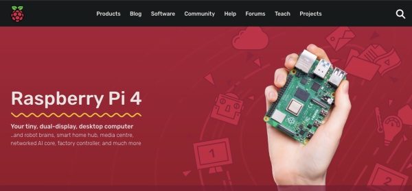

`FlyingDeuk's`
> 2021년 당시 설치 환경과 많이 바뀐거 같다. 라즈베리파이의 업데이트도 끝난거 같고 Home Assistance를 알아보다가 32Bit에는 한계가 있다는 것을 느끼고 다시 도전해 보기로...
> 64Bit Light 버전(No Desktop)에 OpenMediaVault를 올려보기로...
> 최종은 Home Assistance로 애플 홈 서버를 만드는 것임....

--------

# 새롭게 도전하는 것들
- 라즈베리파이 OS 32Bit -> 64Bit (Light Version)
  - 가능하면 데스크탑 도움없이 CLI로 모든 것을 해보고 싶음. 
- OpenMediaVault : 파일 관리를 조금 더 고급스럽게 NAS 처럼 사용해보기
- DOCKER : DOCKER 설치해서 새로운 어플들 운영해보기
  - Transmisstion
  - Photo Backup
  - 영화 스트리밍 

----------------


```
touch /Volumes/bootfs/ssh 
```


# INDEX

## 기본 설치 및 설정

- ### [Raspberry Pi Install - 라즈베리파이 OS 설치법 (모니터, 키보드 없이)](/posts/Pi-install/)

- ### [Raspberry Pi SSH - 라즈베리파이 SSH CLI 원격제어법, DHCP 설정 (모니터, 키보드 없이)](/posts/Pi-ssh/)

  #### - [Raspberry Pi SSH RSA key - 라즈베리파이 SSH 암호없이 접속하기](/posts/Pi-ssh-keygen/)

- ### [Raspberry Pi VNC - 라즈베리파이 VNC GUI 원격제어법, DHCP 설정 (모니터, 키보드 없이)](/posts/Pi-vnc/)

- ### [Raspberry Pi Setting - 라즈베리파이 기본 설정법 (모니터, 키보드 없이)](/posts/Pi-setting/)

- ### [Raspberry Pi User - 라즈베리파이 사용자 추가법 (pi ID 삭제법)](/posts/Pi-user/)
  #### - [Raspberry Pi User - 라즈베리파이 pi 이름 변경법](/posts/Pi-changepi/)

  #### - [Raspberry Pi sudo - sudo 암호입력 없이 사용하기](/posts/Pi-sudo/)

- ### [Raspberry Pi Port Forward - 라즈베리파이 외부/해외에서 접속하기 (포트포워드)](/posts/Pi-port/)

- ### [Raspberry Pi Storage Mount - USB / SD Card Memory 재부팅시 자동 Mount 하기](/posts/Pi-mount/)

## 미디어/파일 서버 설정

- ### [Raspberry Pi DLNA/UPnP - 라즈베리파이 DLNA/UPnP 미디어 서버로 사용하기(by minidlna)](/posts/Pi-dlna/)

- ### [Raspberry Pi FTP - 라즈베리파이 ftp 파일서버로 사용하기(by vsftpd)](/posts/Pi-ftp/)

- ### [Raspberry Pi SAMBA - 라즈베리파이 SAMBA 파일서버로 사용하기(by samba)](/posts/Pi-samba/)

- ### [Raspberry Pi transmission - 라즈베리파이 토렌트(Torrent) 머신으로 사용하기(by transmission-daemon)](/posts/Pi-trans/)
  #### - [Raspberry Pi transmission - Transmission-Daemon 소유권(권한) 문제 해결법](/posts/Pi-trans-own/)

## 미디어 센터 설정

- ### [Raspberry Pi KODI - KODI Media Center 설치법 (by Terminal)](/posts/Pi-kodi/)

  #### - [Raspberry Pi KODI VNC Control - KODI VNC로 Control하는 법 (by Direct Capture Mode)](/posts/Pi-kodi-vnc/)


-----------

## [< Back to DEVICE INDEX >](/categories/device/)
